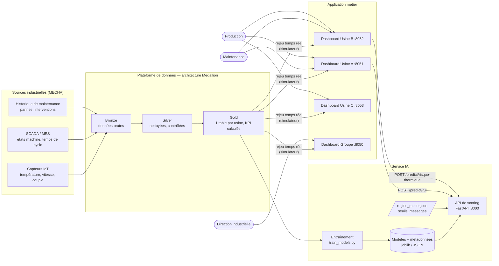
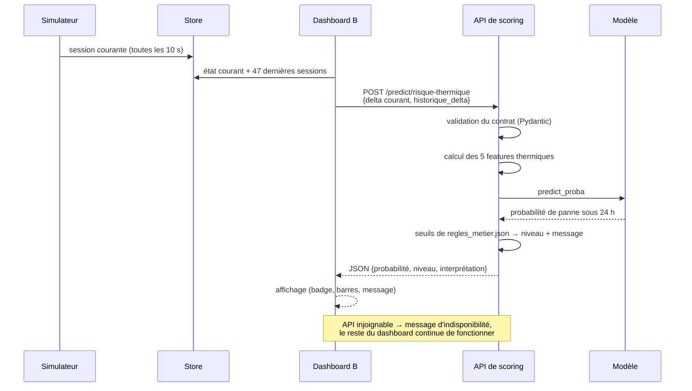

# 02 — Architecture de la solution

> Compétence visée : *concevoir une architecture applicative distribuée ou micro-services,
> évolutive et tolérante aux pannes, adaptée au système d'information existant.*

## 1. Vue d'ensemble

La solution est découpée en services indépendants qui communiquent par HTTP/JSON. Chaque
service tourne dans son propre conteneur.

Dans le prototype, les sources industrielles sont remplacées par le jeu public AI4I 2020 et
par des données simulées ; un **simulateur** rejoue les tables Gold comme un flux temps réel.

## 2. Composants

| Composant | Rôle | Technologie | Emplacement |
|---|---|---|---|
| Pipeline Medallion | Ingestion, nettoyage, calcul des KPI | Python, pandas, Parquet | `notebooks/00` à `04`, `data/` |
| Entraînement | Construction des cibles, comparaison et sélection des modèles | scikit-learn | `mspr841/ml/train_models.py` |
| Features partagées | Définition unique des variables, commune à l'entraînement et à l'API | Python | `mspr841/api/features.py` |
| API de scoring | Expose les prédictions et applique les règles métier | FastAPI, Pydantic, Uvicorn | `mspr841/api/` |
| Règles métier | Seuils d'alerte et messages, modifiables sans code | JSON | `mspr841/api/regles_metier.json` |
| Simulateur | Rejoue les données Gold session par session | Python, thread | `dashboard/simulator.py` |
| Store | État courant, tampon 24 h, alertes | Mémoire, verrous | `dashboard/store.py` |
| Moteur KPI / alertes | TRS, agrégations, règles SPC | Python | `dashboard/kpi_engine.py`, `alert_engine.py` |
| Dashboards | Écrans métiers, onglet IA | Dash, Plotly | `dashboard/app_*.py` |
| Orchestration | Lancement de la stack | Docker Compose | `docker-compose.yml` |
| Intégration continue | Lint, tests, entraînement, build et test des images | GitHub Actions | `.github/workflows/ci.yml` |

## 3. Flux d'une prédiction (Usine B)

## 4. Choix d'architecture et justification

### Pourquoi séparer l'IA de l'application (micro-service)

| Critère | Apport de la séparation |
|---|---|
| **Stabilité** | Une erreur dans le modèle ou l'API n'arrête pas les dashboards : l'appel a un délai maximal de 2 s et un affichage de repli. La supervision de la production ne dépend jamais de l'IA. |
| **Efficacité** | Les modèles sont chargés une seule fois au démarrage de l'API ; une prédiction est un calcul en mémoire de quelques millisecondes. Un seul service sert tous les dashboards. |
| **Pérennité** | Le modèle peut être ré-entraîné ou remplacé sans toucher à l'application, tant que le contrat d'API est respecté. D'autres applications (GMAO, MES, mobile) peuvent consommer la même API. |

### Autres décisions

| Décision | Alternative écartée | Raison |
|---|---|---|
| API REST / JSON | Accès direct des dashboards aux fichiers de modèles | Contrat explicite, validation des entrées, réutilisable par d'autres systèmes |
| Features dans un module partagé | Recalcul séparé côté entraînement et côté API | Supprime tout écart entre ce que le modèle a appris et ce qu'il reçoit en service |
| Seuils dans un fichier JSON | Seuils écrits dans le code | Réglables par site sans développement ni ré-entraînement |
| Modèles versionnés dans Git (quelques Ko) | Stockage externe | Image Docker reproductible ; un registre de modèles est prévu à l'échelle industrielle |
| Un conteneur par dashboard | Une seule application multi-usines | Déploiement et redémarrage indépendants par site |
| Parquet pour la couche Gold | Base relationnelle | Lecture analytique rapide, typage conservé, suffisant pour le volume du prototype |

## 5. Tolérance aux pannes

| Défaillance | Comportement | Mécanisme |
|---|---|---|
| API de scoring arrêtée | L'onglet IA affiche « API indisponible », les autres onglets fonctionnent | `try/except` + `timeout=2` dans les dashboards |
| Modèle absent ou illisible | L'API démarre, répond `503` sur les prédictions ; le healthcheck la déclare non saine | Chargement protégé dans `main.py`, healthcheck sur `modeles_ok` |
| Requête invalide | Rejet `422` avec le détail du champ fautif | Schémas Pydantic bornés |
| Capteur manquant (Usine A) | Valeur médiane d'entraînement utilisée | `valeurs_par_defaut` des métadonnées |
| Historique absent (Usine B) | Prédiction en mode dégradé, signalée par `mode_degrade: true` | `features.py` |
| Plantage d'un conteneur | Redémarrage automatique | `restart: unless-stopped` |
| Dashboard lancé avant l'API | Attente que l'API soit saine | `depends_on: condition: service_healthy` |

## 6. Environnement technique

| Domaine | Choix |
|---|---|
| Langage | Python 3.11 (images), compatible 3.13 |
| IA | scikit-learn 1.8, pandas, NumPy, joblib |
| API | FastAPI, Pydantic v2, Uvicorn ; documentation OpenAPI générée à `/docs` |
| Interface | Dash 2.18, Plotly |
| Conteneurs | Docker, Docker Compose, images `python:3.11-slim`, utilisateur non privilégié pour l'API |
| Qualité | pytest, flake8, GitHub Actions |
| Gestion du code | Git, GitHub, branches de fonctionnalité, pull requests |

## 7. Architecture cible à l'échelle industrielle

Le prototype remplace certaines briques par des équivalents simples. La cible est la suivante.

| Brique | Prototype | Cible MECHA |
|---|---|---|
| Collecte | Fichiers CSV, simulateur | Passerelles OPC UA / MQTT depuis les automates, bus Kafka (un premier essai Kafka → Prometheus → Grafana existe dans `PoCMSPR/`) |
| Stockage | Fichiers Parquet | Lac de données + entrepôt, base de séries temporelles pour les capteurs |
| État applicatif | Mémoire du processus | Redis ou base partagée, pour plusieurs instances |
| Modèles | Fichiers versionnés dans Git | Registre de modèles (MLflow), suivi de dérive, ré-entraînement planifié |
| API | 1 instance | Plusieurs instances derrière un répartiteur de charge, authentification, HTTPS |
| Orchestration | Docker Compose | Kubernetes ou équivalent, un déploiement par site + un niveau groupe |
| Supervision | Healthcheck Docker | Métriques Prometheus, tableaux Grafana, alertes d'exploitation |

Les prérequis et limites de ce passage à l'échelle sont détaillés dans le document 06.
