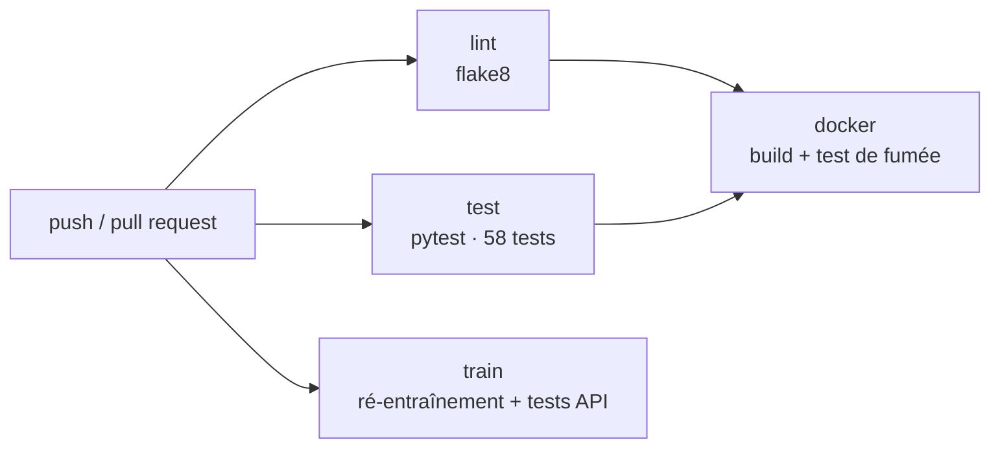

# 06 — Déploiement, intégration continue et mise en œuvre dans les usines

> Compétence visée : *appliquer l'intégration continue à l'aide d'un outil dédié afin de
> vérifier la conformité de la solution.*

## 1. Conteneurisation

| Image | Dockerfile | Contenu | Port |
|---|---|---|---|
| API de scoring | `mspr841/api/Dockerfile` | FastAPI, modèles, règles métier ; utilisateur non privilégié ; healthcheck | 8000 |
| Dashboard | `dashboard/Dockerfile` | Dash + données Gold ; une image, quatre services selon `APP_MODULE` | 8050 à 8053 |

`docker-compose.yml` assemble cinq services : `api`, `dashboard_groupe`,
`dashboard_usine_a`, `dashboard_usine_b`, `dashboard_usine_c`.

Points de conception :

- **Image autonome** : les modèles et leurs métadonnées sont embarqués ; aucune étape manuelle avant le lancement.
- **Healthcheck métier** : l'API n'est déclarée saine que si les modèles sont chargés (`modeles_ok`).
- **Ordre de démarrage** : les dashboards A et B attendent que l'API soit saine (`depends_on: service_healthy`).
- **Réseau interne** : les dashboards appellent `http://api:8000` (variable `MECHA_API_URL`) ; seuls les ports utiles sont publiés.
- **Redémarrage automatique** : `restart: unless-stopped`.
- **Moindre privilège** : l'API ne tourne pas en `root`.

### Exécuter la solution

Prérequis : Docker 24 ou plus récent avec Compose v2, 2 Go de mémoire libre, ports 8000 et
8050 à 8053 disponibles.

```bash
git clone https://github.com/Jason-Tch24/mspr.git && cd mspr
docker compose up -d --build        # construit et démarre
docker compose ps                   # état des services
docker compose logs -f api          # journaux de l'API
docker compose down                 # arrêt
```

| Variable | Service | Rôle | Défaut |
|---|---|---|---|
| `MECHA_API_URL` | dashboards | Adresse de l'API de scoring | `http://localhost:8000` |
| `MECHA_REGLES_PATH` | API | Fichier de règles métier | `./regles_metier.json` |
| `MECHA_MODELS_DIR` | API | Dossier des modèles | `./models` |
| `APP_MODULE` | dashboard | Dashboard à lancer | `app_groupe` |

## 2. Intégration continue

Outil : **GitHub Actions**, fichier `.github/workflows/ci.yml`. Déclenchement à chaque push
sur `main` ou sur une branche `feature/**`, et à chaque pull request vers `main`.



| Job | Ce qu'il vérifie | Fonctionnalités de l'outil utilisées |
|---|---|---|
| `lint` | Aucune erreur de syntaxe ni nom indéfini dans `dashboard/` et `mspr841/` | Environnement Python géré par l'action `setup-python` |
| `test` | Les 58 tests unitaires et d'intégration | Cache des dépendances, publication du rapport `junit.xml` en artefact |
| `train` | Les modèles se régénèrent à partir des données versionnées et l'API fonctionne avec eux | Artefact `benchmark_841.json` |
| `docker` | Les images se construisent, l'API démarre saine, une prédiction réelle renvoie `CRITICAL` pour un outil usé à 88 % | Dépendance entre jobs (`needs`), `docker compose up --wait` |

Ce que la CI garantit : une modification qui casse un calcul, le contrat de l'API, les
performances minimales des modèles ou la construction des images est détectée avant la
fusion dans `main`.

### Gestion du code source

- Dépôt GitHub ; la CI s'exécute sur `main`, sur les branches `feature/**` et sur chaque pull request.
- Une branche par évolution (`feature/...`), fusion par pull request.
- Messages de commit préfixés (`feat`, `fix`, `docs`, `test`, `ci`).
- Dépendances figées (`requirements.txt` par composant, `requirements-dev.txt` pour le développement).

## 3. Exploitation

| Tâche | Fréquence | Comment |
|---|---|---|
| Vérifier la santé du service | Continu | `GET /` ; healthcheck Docker |
| Consulter les performances des modèles | À chaque version | `GET /models` |
| Ajuster les seuils d'alerte | À la demande de la maintenance | Modifier `regles_metier.json`, redéployer l'API |
| Ré-entraîner les modèles | Quand de nouvelles données sont disponibles | `python mspr841/ml/train_models.py`, pull request, CI |
| Revenir à la version précédente | En cas de régression | Redéployer l'image du commit précédent |

## 4. Projection de mise en œuvre dans les usines de MECHA

### Déploiement progressif

| Phase | Durée indicative | Périmètre | Condition de passage |
|---|---|---|---|
| 0. Préparation | 1 à 2 mois | Inventaire des capteurs et de l'historique de pannes, raccordement SCADA / MES d'un site | Six mois d'historique fiable disponibles |
| 1. Mode observation | 2 à 3 mois | Un site pilote, une ligne ; l'IA tourne mais ses alertes ne déclenchent aucune action | Modèles recalibrés sur données réelles ; précision des alertes mesurée |
| 2. Pilote opérationnel | 3 mois | Même site ; la maintenance agit sur les alertes | Fausses alertes à un niveau accepté par la maintenance ; arrêts non planifiés en baisse |
| 3. Extension France | 6 mois | Les deux autres sites français | Modèles recalibrés par site ; équipes formées |
| 4. Extension Espagne | 6 mois | Les deux sites espagnols | Interface et supports traduits ; hébergement conforme |
| 5. Régime permanent | — | Cinq sites | Suivi de dérive et ré-entraînement planifiés |

Le mode observation est la garantie que l'IA ne perturbe pas la production tant qu'elle n'a
pas fait ses preuves sur des données réelles.

### Contraintes propres aux usines

| Contrainte | Réponse |
|---|---|
| Continuité de la production | L'IA est un service d'aide à la décision, hors de la boucle de commande des machines ; son arrêt n'a aucun effet sur la production. |
| Disponibilité des équipements | Installation sans arrêt machine : la solution lit des données déjà collectées. |
| Sécurité des systèmes industriels | Flux en lecture seule depuis le réseau atelier vers le réseau informatique, à travers une zone tampon ; aucun flux entrant vers les automates. |
| Sites hétérogènes | Un déploiement par site, des règles et des modèles propres à chaque site, un niveau groupe pour la consolidation. |
| Réseau entre sites | Chaque site fonctionne de façon autonome ; la consolidation groupe tolère une coupure. |

### Impacts

| Nature | Impact |
|---|---|
| Technique | Raccordement aux sources (OPC UA / MQTT), stockage des séries temporelles, hébergement des conteneurs par site, supervision |
| Organisationnel | Nouveau rôle de référent IA par site ; revue hebdomadaire des alertes ; procédure de réglage des seuils ; la maintenance passe du préventif calendaire au conditionnel |
| Humain | Formation des techniciens et responsables (document 08) |

### Prérequis pour l'échelle industrielle

1. Un historique réel de pannes daté et qualifié par cause, sur au moins six mois par site.
2. Des capteurs synchronisés (horodatage commun) et une mesure de la qualité des données.
3. Une authentification sur l'API et les dashboards, et des échanges chiffrés.
4. Un stockage partagé de l'état applicatif, aujourd'hui en mémoire du processus.
5. Un registre de modèles et un suivi de dérive (les données de production changent dans le temps).
6. Une supervision d'exploitation (métriques, journaux centralisés, alertes d'astreinte).

### Limites et points de vigilance

- **Performance non démontrée sur données réelles** : les scores actuels dépendent des règles de simulation.
- **Fausses alertes** : même au niveau « Normal », des pannes surviennent ; l'outil priorise, il ne garantit pas.
- **Fréquence d'appel** : le prototype interroge l'IA à chaque rafraîchissement d'écran ; à l'échelle, un calcul par nouvelle session, mis en cache.
- **Volume** : 4 machines par usine dans le prototype ; des centaines de machines demandent un traitement par lots et plusieurs instances de l'API.
- **Maille temporelle** : sessions de 30 minutes ; les défaillances rapides (vibrations, casse) demandent des signaux haute fréquence et d'autres modèles.
- **Historisation** : les prédictions ne sont pas conservées ; indispensable pour mesurer la précision réelle des alertes et pour la traçabilité exigée par les clients.
