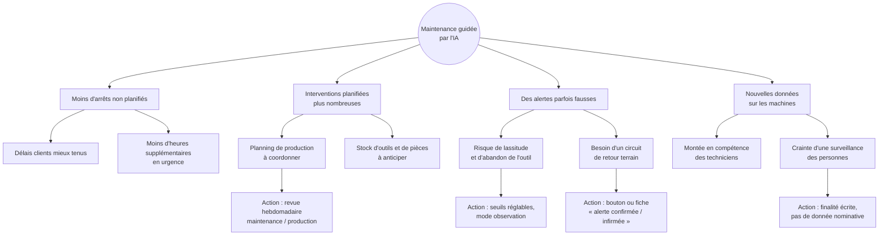
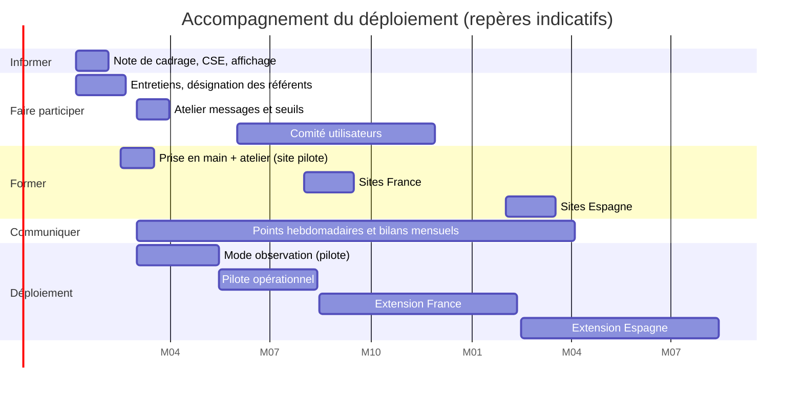

# 08. Conduite du changement et accompagnement des métiers

> Compétence visée : *conduire le changement auprès des métiers lors du déploiement, par une
> démarche de participation, de communication et de formation.*

## 1. Ce qui change

| Aujourd'hui | Demain |
|---|---|
| Maintenance préventive sur calendrier fixe, ou curative après la panne | Maintenance conditionnelle : on intervient quand l'état de la machine le justifie |
| L'information arrive après l'arrêt | Un niveau de risque est disponible 24 h avant |
| Le technicien décide sur son expérience seule | Il décide avec un indicateur supplémentaire, qu'il peut contester |
| Les seuils sont figés dans les automates | Les seuils d'alerte de l'IA sont réglables par le responsable maintenance |

Le changement porte moins sur l'outil que sur la façon de décider : faire confiance à
une estimation, sans lui obéir aveuglément.

## 2. Acteurs concernés

| Acteur | Impact | Attitude probable | Levier |
|---|---|---|---|
| Techniciens de maintenance | Fort : leur priorisation quotidienne change | Méfiance : « la machine, je la connais mieux qu'un algorithme » | Les associer au réglage des seuils ; valoriser leurs retours |
| Responsables maintenance | Fort : nouvelle façon de planifier | Intérêt, crainte d'être jugés sur les alertes manquées | Clarifier que l'outil aide, la responsabilité ne change pas |
| Responsables de production | Moyen : arrêts planifiés à intégrer | Favorables si les arrêts imprévus baissent | Montrer le gain en disponibilité |
| Opérateurs | Faible : pas d'usage direct | Inquiétude : surveillance des personnes ? | Dire explicitement que l'outil suit les machines, pas les salariés |
| Direction qualité | Moyen : traçabilité | Favorable | Les impliquer dans les messages et la validation |
| DSI / équipe data | Fort : exploitation d'un nouveau service | Charge supplémentaire | Automatisation (CI, conteneurs), documentation |
| Direction industrielle | Sponsor | Attente de résultats rapides | Indicateurs de suivi, jalons réalistes |
| Représentants du personnel | Consultés | Vigilance | Information en amont, finalité limitée à la maintenance |

## 3. Outils de conduite du changement mobilisés

### 3.1 Modèle de transition de William Bridges

Le changement est un événement ; la transition est ce que vivent les personnes. Elle passe
par trois phases, à accompagner différemment.

| Phase | Ce que vivent les équipes | Actions |
|---|---|---|
| 1. La fin : quitter l'ancien | Perte de repères : le planning préventif rassurait ; crainte de voir son expertise remplacée | Reconnaître ce qui fonctionnait ; dire ce qui ne change pas (la décision reste humaine, le préventif réglementaire est maintenu) ; expliquer pourquoi changer (coût des arrêts imprévus) |
| 2. La zone neutre : l'entre-deux | Double fonctionnement, doutes, fausses alertes, charge de travail accrue | Mode observation sans conséquence ; référent IA présent dans l'atelier ; points hebdomadaires courts ; droit à l'erreur affiché ; corriger vite les irritants |
| 3. Le nouveau départ | L'outil entre dans la routine | Célébrer les premières pannes évitées ; intégrer l'onglet IA au rituel de prise de poste ; confier le réglage des seuils aux équipes |

### 3.2 Roue du futur (Future Wheel)

Changement central : « la maintenance agit sur des alertes prédictives ».

Les effets négatifs de second rang (lassitude, crainte de surveillance, coordination du
planning) sont ceux que le plan d'action traite en priorité.

## 4. Plan d'action sur les quatre axes

### Informer

| Action | Cible | Quand | Responsable |
|---|---|---|---|
| Note de cadrage : pourquoi, pour qui, calendrier, ce qui ne change pas | Tous les salariés du site pilote | Phase 0 | Direction industrielle |
| Information des représentants du personnel sur la finalité et les données | CSE | Phase 0 | Direction du site + DPO |
| Affichage en atelier : « l'outil suit les machines, pas les personnes » | Opérateurs, techniciens | Phase 0 | Responsable maintenance |
| Guide utilisateur de deux pages (document 07) | Utilisateurs | Phase 1 | Équipe projet |

### Communiquer

| Action | Cible | Quand | Responsable |
|---|---|---|---|
| Réunion de lancement avec démonstration des scénarios de panne injectée | Maintenance, production | Phase 1 | Équipe projet |
| Point hebdomadaire de 15 minutes : alertes de la semaine, confirmées ou non | Maintenance | Phases 1 à 3 | Référent IA |
| Tableau de bord du déploiement : pannes évitées, fausses alertes, taux d'usage | Direction, équipes | Mensuel | Responsable maintenance |
| Retours d'expérience du site pilote présentés aux sites suivants par les techniciens eux-mêmes | Sites suivants | Avant chaque extension | Techniciens du pilote |

### Former

| Module | Public | Durée | Contenu | Support |
|---|---|---|---|---|
| Prise en main | Techniciens, responsables maintenance et production | 1 h 30 | Lire l'onglet IA, niveaux et actions, limites | Guide utilisateur, démonstration |
| Atelier pratique | Techniciens | 1 h | Scénarios « dissipation dégradée », « usure critique » sur la plateforme de démonstration | Boutons d'injection de panne |
| Réglage des seuils | Responsables maintenance, référents IA | 2 h | Effet d'un seuil sur les alertes, lecture du tableau taux de panne par niveau | Document 04 §3 |
| Exploitation | DSI / équipe data | Une demi-journée | Déploiement, supervision, ré-entraînement, retour arrière | Document 06, README |
| Sensibilisation | Direction, qualité | 45 min | Ce que l'IA fait et ne fait pas, indicateurs de suivi | Support de soutenance |

Format : sessions courtes en atelier, sur le temps de travail, par groupes de six ;
un mémo plastifié près des postes ; une session de rappel un mois après.

### Faire participer

| Action | Cible | Quand |
|---|---|---|
| Entretiens de recueil des besoins (document 01) | Tous les profils | Phase 0 |
| Désigner un référent IA volontaire par site, issu de la maintenance | Techniciens | Phase 0 |
| Atelier de rédaction des messages d'alerte avec les techniciens | Maintenance, qualité | Phase 1 |
| Réglage collectif des seuils à partir des alertes du mode observation | Maintenance | Fin de phase 1 |
| Circuit de retour « alerte confirmée / infirmée », utilisé pour ré-entraîner les modèles | Techniciens | Phases 1 à 5 |
| Comité utilisateurs trimestriel, qui priorise les évolutions | Référents des cinq sites | Régime permanent |

## 5. Mise en application : ce que la solution fournit déjà

| Besoin d'accompagnement | Élément de la solution |
|---|---|
| Montrer sans risque ce qui se passe en cas de dégradation | Boutons d'injection de panne dans l'onglet Prédictions IA : support de démonstration et d'atelier pratique |
| Donner la main aux métiers sur les alertes | Seuils et messages dans `regles_metier.json`, modifiables sans développement |
| Rendre l'IA explicable | Modèle retenu, performance et limites affichés et consultables (`GET /models`) |
| Ne pas créer de dépendance | Les dashboards fonctionnent si l'IA est arrêtée |
| Documenter pour l'utilisateur | Guide de deux pages (document 07, partie B) |

## 6. Calendrier

## 7. Mesure de l'adoption

| Indicateur | Cible à 6 mois (site pilote) |
|---|---|
| Part des techniciens formés | 100 % |
| Consultation de l'onglet IA à la prise de poste | Au moins 4 postes sur 5 |
| Alertes « À risque » et « Critique » suivies d'un contrôle | Au moins 80 % |
| Alertes qualifiées (confirmée / infirmée) par le terrain | Au moins 70 % |
| Arrêts non planifiés | En baisse par rapport à la période de référence |
| Satisfaction des utilisateurs (questionnaire court) | Majorité d'avis favorables |

## 8. Risques et parades

| Risque | Parade |
|---|---|
| Rejet par les techniciens expérimentés | Référents issus de leurs rangs ; l'outil est présenté comme un second avis |
| Lassitude face aux fausses alertes | Mode observation, seuils réglés avec eux, bilan hebdomadaire |
| Confiance excessive dans l'outil | Formation aux limites ; maintien du préventif réglementaire |
| Crainte d'une surveillance individuelle | Aucune donnée nominative ; finalité écrite ; information du CSE |
| Essoufflement après le pilote | Comité utilisateurs, indicateurs publiés, retours d'expérience entre sites |
| Barrière de la langue (sites espagnols) | Interface, messages d'alerte et supports traduits ; formateurs locaux |
